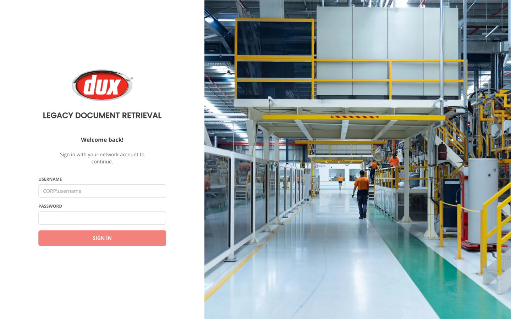
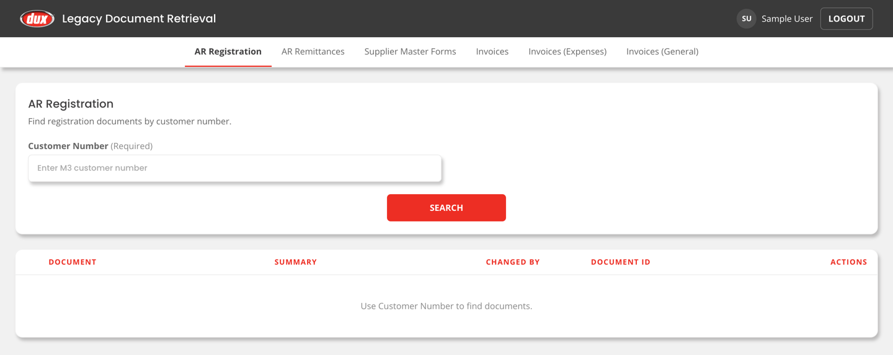
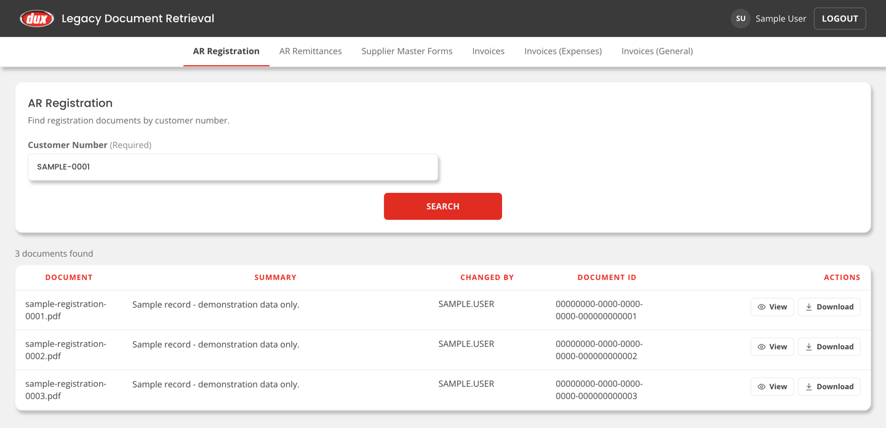
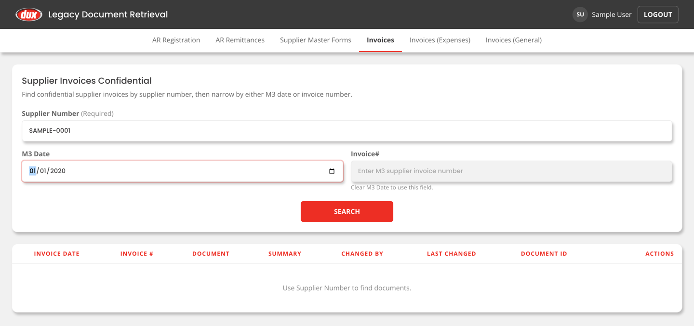
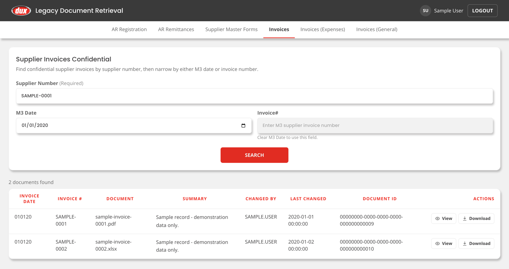
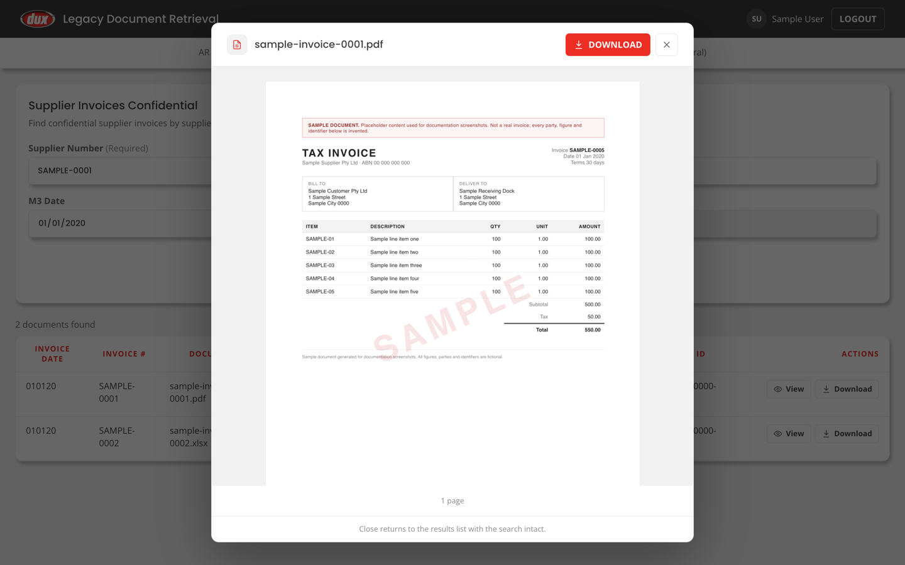

<div align="center">

# DUX Vault — Legacy Document Retrieval

**Find a 2015 supplier invoice by its M3 number, and read it in the browser.**

A document search and retrieval app over a legacy Infor IDM archive: React + TypeScript on
the front, FastAPI on the back, SQL Server and Active Directory behind it.



</div>

---

## The problem

A manufacturer had years of accounts-payable and accounts-receivable paperwork — credit
applications, remittance advices, supplier master forms, supplier invoices — sitting in an
Infor IDM archive on a file server. The documents were still there. Finding one was not
practical.

Two things stood in the way:

1. **The metadata and the files live in different places.** IDM's SQL database knows that a
   document exists and which business keys it carries, but it identifies the file only by a
   `RESOURCEID` GUID. The file server holds the bytes, in a folder tree where every file is
   named as a bare GUID with **no extension** — so neither half can find a document on its own.
2. **Some of it is confidential.** Supplier invoices under legal or commercial sensitivity
   cannot be opened by everyone who can open an ordinary invoice.

DUX Vault closes the gap. It indexes the file tree into a lookup table, joins that to the
IDM metadata on `RESOURCEID`, and puts a search box in front of it — with the sensitive
option gated by Active Directory group membership and enforced per document, not per menu item.

---

## What it looks like

### Search, then open

Each of the six document types gets its own search page, built from a shared template. The
mandatory key is the business number the user already knows — customer, payer, or supplier.



Results are the columns the option's SQL returns, with `View` and `Download` on every row.



### Filters that cannot be set wrongly

On four of the six options the key can be narrowed by **either** a date **or** a document
number — never both, because a document number already identifies a single row and adding a
date to it only produces a confusing empty result.

Rather than validate the bad combination after the fact, filling one field **disables** the
other and says which field to clear. The invalid state is simply unreachable in the form, so
no error message is needed — and the API rejects the pair independently, because the browser
is not a security boundary.



### The confidential option

`Supplier Invoices (Confidential)` is only rendered for users in the confidential group — and
the check is repeated server-side on the search, the view and the download.



### Read it without downloading it

`View` opens an overlay viewer: PDFs render page by page through `react-pdf`, spreadsheets
are parsed into sheet tabs with `xlsx`. The menu bar stays visible, and closing the viewer
returns to the results list with the search and its results intact.



> Every value shown above is placeholder data. See [Screenshots](#screenshots).

---

## How a document is found

The join between the two databases is the whole trick:

```
  User types a supplier number
            │
            ▼
  ┌──────────────────────────────────┐
  │ Infor_*_DocMgmt . idm . <view>   │   IDM metadata — one view per option
  │                                  │
  │   M3_Supplier_Number  128679     │
  │   RESOURCENAME        inv.pdf    │ ──┐  extension for viewer + download name
  │   RESOURCEID          0000540b…  │ ──┼─┐
  └──────────────────────────────────┘   │ │
                                         │ │  join on the GUID
  ┌──────────────────────────────────┐   │ │
  │ DUX_DocMgmt . dbo . Document     │ ◄─┘ │
  │                                  │     │
  │   ResourceId    0000540b…        │ ◄───┘
  │   DocumentPath  e:\DATA1\IT\…    │ ──┐
  └──────────────────────────────────┘   │  canonical Windows path
                                         ▼
                        root substitution: DOC_ROOT_CANONICAL → DOC_ROOT_LOCAL
                                         │
                                         ▼
                        /mnt/idm/infor/infor/9429/0000540b-cfc3-…
                                 (a GUID with no extension)
```

Three details make this work and are easy to get wrong:

- **The file has no extension on disk.** The type is taken from `RESOURCENAME`, which drives
  the viewer choice, the `Content-Type`, and the download filename — so the user receives a
  correctly named, openable file.
- **Path translation is a root substitution, not a drive-letter swap.** The SMB share is
  published from `e:\DATA1\IT\IDMFiles`, so the `\DATA1\IT` segment does not exist on the
  client side. Both roots are configuration values; neither is derived from the other.
- **The frontend never builds a path.** It hands back `RESOURCEID` and `RESOURCENAME` and
  the backend resolves everything else.

---

## Authorisation

Two Active Directory groups, resolved at sign-in over LDAPS and cached for the session:

| Group | Options granted |
| --- | --- |
| General | AR Registration, AR Remittances, Supplier Master Forms, Invoices (Expenses), Invoices (General) |
| Confidential | all of the above **and** Invoices (Confidential) |

The part worth calling out is **what** gets checked. The option in a view or download URL is
supplied by the caller, so checking entitlement against that option alone would leave it
unverified: a user entitled to a General option could name it while passing a Confidential
document's `RESOURCEID`, and the resource id on its own is enough to resolve a path.

So the document is confirmed to belong to the requested option before it is served. A
mismatch is refused as **not found** rather than forbidden — whether an id exists under some
other option is not the caller's business.

A few more deliberate choices:

- **LDAPS fails closed.** A simple bind puts the user's password on the wire, so the app
  refuses to start with SSL on and no CA bundle configured, rather than silently skipping
  certificate validation.
- **TLS is not optional in deployment.** Users type real directory passwords; `make serve`
  runs the whole app over https on one origin.
- **The dev auth bypass cannot reach production.** A startup guard refuses to boot when
  `AUTH_BYPASS_ENABLED` is on and `APP_ENV` is `production` — it returns a fully entitled
  user with no session at all, which would open every endpoint.
- **Confidential access is logged** — user, resource id, timestamp, action.

---

## Stack

| | |
| --- | --- |
| **Frontend** | React 19, TypeScript, Vite, Tailwind CSS v4, React Router, TanStack Query, `react-pdf`, `xlsx` |
| **Backend** | FastAPI, Python 3.12, SQLAlchemy 2.x, `pyodbc`, `pydantic-settings`, `ldap3` |
| **Data** | Microsoft SQL Server — IDM metadata database + document index database |
| **Identity** | Active Directory over LDAPS (simple bind), signed session cookies |
| **Tests** | pytest (backend), Vitest + Testing Library (frontend) |

---

## Repository layout

```
backend/            FastAPI app
  app/
    api/routes/     auth, documents, health endpoints
    auth/           LDAP client, session dependencies, login throttle
    core/           settings and logging
    db/             engines, repository, one query module per option
    schemas/        pydantic request/response models
    services/       file resolution and streaming
    utils/          API envelope, path translation, document helpers
  scripts/          index_documents, fetch_ca_cert, check_ad_login
  tests/            pytest suite
frontend/           React + TypeScript SPA
  src/
    api/            fetch client and envelope unwrapping
    auth/           auth context and route guards
    components/     results grid, search form, viewer, ui primitives
    pages/          six search pages over one shared template
docker/             container build and compose files
docs/               specifications and screenshots
```

---

## Getting started

### Prerequisites

- Python 3.12 and the Microsoft **ODBC Driver 18 for SQL Server**
- Node.js 20+
- Reachable SQL Server instance and, for real sign-in, an Active Directory domain

### 1. Backend

```bash
cd backend
cp .env.example .env.development   # then fill in the values
make install
make dev                           # API only, http://localhost:8000
```

For sign-in against a real directory you also need the CA bundle that issued the domain
controller certificates. Active Directory publishes it in the directory itself:

```bash
PYTHONPATH=. .venv/bin/python scripts/fetch_ca_cert.py --user 'CORP\yourname'
```

This writes `certs/corp-ca.pem` and needs a real terminal, since it prompts for a password.
Sign-in fails closed without it. `scripts/check_ad_login.py` reports what the app sees for a
given account when a login is refused.

To develop without a directory at all, set `AUTH_BYPASS_ENABLED=true` in
`.env.development` — it is refused in production by a startup guard.

### 2. Document index

The archive is static, so this is a one-off load — but the script upserts on `ResourceId`,
so it is safe to re-run:

```bash
cd backend
PYTHONPATH=. .venv/bin/python scripts/index_documents.py
```

### 3. Frontend

```bash
cd frontend
npm install
npm run dev                        # http://localhost:5173
```

### 4. Serve it as one app

The backend serves the built SPA itself, so the whole app runs on a single origin:

```bash
cd backend
make build-frontend   # builds the SPA into backend/static/
make tls-cert         # once
make serve            # https on 0.0.0.0:8000, prints the URL
```

Same-origin is worth preferring: it removes CORS, keeps the session cookie same-site, makes
deep-link refreshes work, and lets the document viewers inherit the session.

> The backend URL is baked into the bundle at build time, so re-run `make build-frontend`
> after any frontend change or you will serve a stale app.

---

## Commands

| Backend (`cd backend`) | |
| --- | --- |
| `make install` | install Python dependencies |
| `make dev` | run FastAPI with reload |
| `make build-frontend` | build the SPA into `backend/static/` |
| `make tls-cert` | generate a self-signed TLS certificate |
| `make serve` | serve the whole app over https |
| `make url` | print the URL to hand out |
| `make test` | run the pytest suite |
| `make lint` / `make format` | Ruff check / format |
| `make check` | compile, lint and test |

| Frontend (`cd frontend`) | |
| --- | --- |
| `npm run dev` | start Vite |
| `npm run build` | typecheck and build production assets |
| `npm run lint` | ESLint |
| `npm run test` | Vitest |

---

## Configuration

All environment-specific values are configuration, never hard-coded. See
[`backend/.env.example`](backend/.env.example) for the full list; the ones that matter most:

| Key | Purpose |
| --- | --- |
| `DB_SERVER`, `DB_USER`, `DB_PASSWORD` | SQL Server connection |
| `DOC_ROOT_CANONICAL` | the Windows path form stored in the database |
| `DOC_ROOT_LOCAL` | where that root is actually mounted on this host |
| `LDAP_SERVERS`, `LDAP_PORT`, `LDAP_USE_SSL` | domain controllers; comma-separate for failover |
| `LDAP_CA_CERT_FILE` | CA bundle for the DC certificates — required when SSL is on |
| `LDAP_GROUP_GENERAL`, `LDAP_GROUP_CONFIDENTIAL` | the two entitlement groups |
| `SESSION_SECRET`, `SESSION_COOKIE_SECURE` | session cookie signing and transport |
| `AUTH_BYPASS_ENABLED` | development only; blocked in production by a startup guard |

No credentials are committed. `.env*` files, the generated CA bundle and the self-signed TLS
pair are all ignored by git.

---

## Screenshots

The screenshots in `docs/screenshots/` are captured from the real running frontend, driven
by Playwright against a stub API that serves placeholder rows — not from the production
system and not from mockups.

Every value in them is a deliberate placeholder: supplier and invoice numbers are
`SAMPLE-0001`, document ids are all-zero GUIDs, the signed-in user is `Sample User`, and the
document in the viewer is a watermarked specimen. Nothing in the archive, and no real
supplier, customer, amount or person, appears anywhere in them.

---

## Documentation

- [docs/app-spec.md](docs/app-spec.md) — business rules, the six options, SQL per option, error handling and the design decisions behind them.
- [docs/technical-spec.md](docs/technical-spec.md) — codebase layout, auth flow, API envelope, file resolution, and where to put new code.
- [CONTRIBUTING.md](CONTRIBUTING.md) — file placement conventions and how to work safely with git.

## Licence

[MIT](LICENSE)
